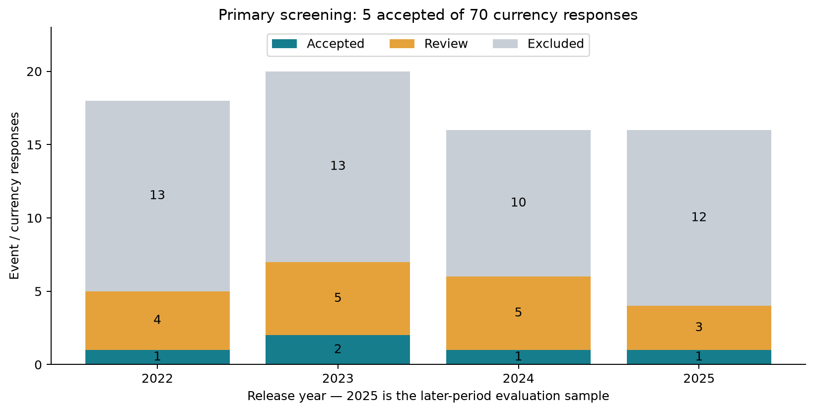
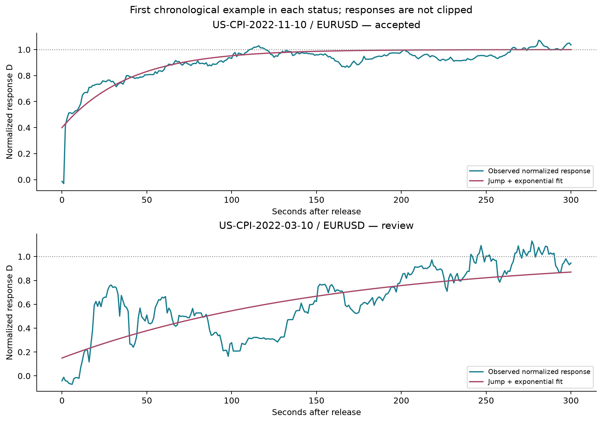
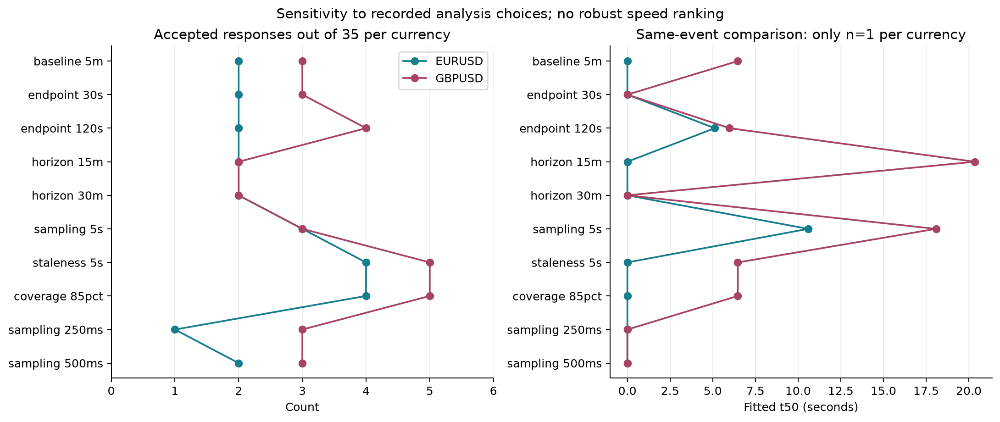

# Market Information Diffusion

**How quickly do FX prices adjust after US CPI announcements?**

A commented Python event-study pipeline with real-data provenance checks, causal quote sampling, jump/exponential fitting and robustness analysis.

## Results at a glance

- 35 US CPI dates across 2022–2025; EUR/USD and GBP/USD.
- 70 source archives scanned; 478,393 event-window quotes retained.
- 5 accepted, 17 review and 48 excluded responses under recorded primary screens.
- Ten sensitivity scenarios and a completed 2025 later-period evaluation.
- No robust currency speed ranking or profitable trading signal established.



The central research finding is that data coverage and model assumptions materially limit speed estimates. This is an information-response study, not a generative AI diffusion model.

## Quick start

```sh
python3 -m venv .venv
source .venv/bin/activate
python -m pip install -e .
python -m market_diffusion demo --output results/demo
python -m unittest discover -s tests -q
```

The demo uses explicitly labelled synthetic data. The included figures and study
summary describe the historical CPI study; exact empirical reproduction requires
the original audited inputs, which are not distributed.

## Explore in five minutes

1. Read the [one-page project brief](docs/project-brief.md).
2. Open the [guided notebook](notebooks/02_portfolio_walkthrough.ipynb).
3. Read the [full report and mathematics](docs/research-report.md).
4. Follow [setup and reproduction](docs/reproduction.md) to run a synthetic example or the audited local-data workflow.

Core analysis uses Python's standard library (3.9+). Optional plotting dependencies are separated from runtime requirements. The public package excludes third-party observations, credentials and local environments. Included charts and aggregate summaries document the real study; the runnable demonstration uses labelled synthetic data.

See [release checks](docs/release-checks.md) for the completed reproducibility comparison and fresh test results. No license is granted for third-party market data.

## View the outputs

The empirical charts below are included in the repository and display directly on GitHub. They summarize the recorded HistData study; they are not outputs from the synthetic demonstration.

### Fitted price responses



### Sensitivity to research choices



See the [aggregate study results](docs/study-summary.json), [research report](docs/research-report.md), and [executed walkthrough](notebooks/02_portfolio_walkthrough.ipynb). The walkthrough retains its numerical outputs for reading without running Python, and clearly separates simulated results from empirical evidence.
